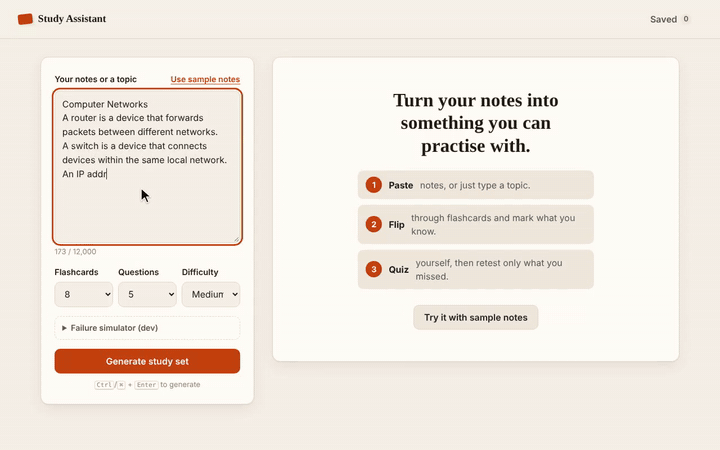

# Study Assistant

Paste your notes (or just type a topic). The app asks an LLM for **structured JSON**, validates it, and turns it into:

- **Flashcards**: flip, mark "got it" / "still learning", then review only the cards you're still learning.
- **A multiple-choice quiz**: instant feedback with explanations, a results screen, and **"Retest N missed"** to re-quiz only what you got wrong.
- **Refinement**: follow-up prompts ("make the quiz harder", "add 3 more flashcards") edit the existing set instead of regenerating it, with undo.
- **Saved sessions** in localStorage, keyboard shortcuts, dark mode, mobile layout.



> Full walkthrough including the failure cases: **[demo video](REPLACE_WITH_VIDEO_LINK)**

The main focus is **handling bad AI output**: malformed JSON, the wrong shape, empty, slow, or failed responses, and stale responses.

---

## Setup

Requires Node 18.17+.

```bash
npm install
npm start          # API on :8787 + Vite on :5173 → open http://localhost:5173
```

**It runs without an API key.** With no key, the server uses a small local mock model ("demo mode") so you can try the whole UI. For real output:

```bash
cp .env.example .env
# then set LLM_PROVIDER and LLM_API_KEY
```

| Provider | `LLM_PROVIDER` | Default model | Key |
|---|---|---|---|
| Groq (free tier) | `groq` | `llama-3.3-70b-versatile` | console.groq.com |
| Google Gemini (free tier) | `gemini` | `gemini-2.5-flash` | aistudio.google.com |
| OpenRouter | `openrouter` | `meta-llama/llama-3.3-70b-instruct:free` | openrouter.ai |
| OpenAI | `openai` | `gpt-4o-mini` | platform.openai.com |
| Ollama (local, free) | `ollama` | `llama3.1` | none |

All five use the OpenAI-compatible `/chat/completions` endpoint, so one code path covers them. Override with `LLM_MODEL` / `LLM_BASE_URL`. If a model rejects `response_format`, set `LLM_JSON_MODE=false`.

Other scripts:

```bash
npm test                       # parser + pipeline tests (node:test, no extra deps)
npm run build && npm run server  # production build served by Express on :8787
```

---

## How it works

```
Browser (React)                         Express server                    LLM provider
───────────────                         ──────────────                    ────────────
InputPanel ──► useStudyRequest ──POST /api/study-set──► validate input
                (abort + request id)                     build prompt ──────► chat/completions
                                                          parseStudySet ◄───── raw text
                                                          ↳ unusable? one repair turn ─► …
StudyView ◄── normalizeStudySet ◄──── { data, warnings, meta } or { error: {code, message, retryable} }
(Flashcards / Quiz / RefineBar)
```

- **The API key stays on the server.** The browser only talks to `/api/*` (Vite proxies it in dev), and the server holds `LLM_API_KEY`.
- **`src/lib/studySet.js`** is the core module: a dependency-free parser and validator shared by the server and the client.
- **`src/hooks/useStudyRequest.js`** is the single request channel: loading/error state, cancel, retry, and the stale-response guard.

### Project layout

```
server/
  index.js       routes, input validation, timeout + client-disconnect abort, error → HTTP mapping
  pipeline.js    model call → parse/validate → one automatic repair attempt
  providers.js   provider presets + the single fetch to /chat/completions
  prompt.js      system prompt, generate / refine / repair messages
  chaos.js       failure simulator (dev only)
  mock.js        offline demo "model"
src/
  lib/studySet.js   extractJson + normalizeStudySet (shared with server)
  lib/api.js        fetch wrapper: timeout, error classification, re-validation
  hooks/            useStudyRequest, useSessions, useHotkeys, useElapsed
  components/       InputPanel, States (empty/loading/error), StudyView, Flashcards, Quiz, RefineBar, SessionsDrawer
tests/              studySet.test.js, pipeline.test.js
```

---

## Handling bad AI output

| Situation | What happens |
|---|---|
| JSON wrapped in ```` ```json ```` fences or chatty prose | `extractJson` strips the fences or takes the outermost `{…}`. Trailing commas are tolerated as a fallback. |
| **Malformed / truncated JSON** | The server sends the bad output back to the model with the parse error and asks for corrected JSON (**one** repair turn). If that fails too, the user sees a clear error with **Try again**. |
| **Valid JSON, wrong shape** | Same repair turn, then an error. Common near-misses are accepted instead of rejected: `question/answer` in place of `front/back`, `"answer": "B"`, `"answer": "Paris"`, options given as an object, a top-level array, or a `{ "data": {...} }` wrapper. |
| **Some items broken** | Bad items are dropped and the rest are kept. Items get dropped for: missing fields, fewer than 2 or more than 6 options, an out-of-range `answerIndex`, or an answer that matches no option. A warning banner says what was left out. Duplicate options are removed *after* resolving the correct answer, so `answerIndex` still points at the right text. |
| **Empty** response, or nothing usable | `EMPTY` is retried. `NO_USABLE_ITEMS` (e.g. the input wasn't studyable) is **not** retried, since asking again wouldn't help, and the user gets a hint to add detail. |
| **Slow** | The loading message changes at 6s and 20s, an elapsed counter is shown, and there's a **Cancel** button. The server aborts the model call after `LLM_TIMEOUT_MS` (25s) and the client gives up at 60s. |
| **Failed** (network, 5xx, 429, bad key) | Each failure maps to a specific message. `retryable` decides whether **Try again** is shown (a bad API key, for example, isn't retryable). If the API server isn't running, a banner says so. |
| **Stale response** | Starting a new request aborts the previous fetch **and** bumps a request id. A response is applied only if its id is still the latest. Abort alone isn't enough, because a response can already be resolving when you abort it. Aborting the fetch also closes the connection, and the server aborts its model call so it doesn't pay for unused tokens. |
| Refinement fails | The current set is left untouched. An inline error says so and offers Retry. |
| Corrupted localStorage | Every saved session is re-validated on load. Bad entries are dropped instead of crashing the app. |
| Untrusted client input | The server validates text length, clamps counts, and re-validates the "current set" sent for refinement. |

The client **re-validates** the server's response with the same `normalizeStudySet`. The UI depends on that shape, so it checks at the boundary instead of trusting the network.

### Try the failures yourself

In dev, open **"Failure simulator (dev)"** under the input. It wraps the real provider call and corrupts the result:
`fenced`, `partial`, `flaky` (malformed once, then fixed by auto-repair, shown with an "auto-repaired" tag), `malformed`, `wrong-shape`, `empty`, `slow`, `hang`, `fail`, `rate-limit`.

**To see stale handling:** pick `slow`, click Generate, switch the simulator to *Off*, change the notes, and Generate again. The second result appears, and the slow first response never overwrites it.

The simulator is disabled when `NODE_ENV=production` or `ALLOW_CHAOS=false`.

---

## Keyboard shortcuts

| | |
|---|---|
| Flashcards | <kbd>Space</kbd>/<kbd>Enter</kbd> flip · <kbd>←</kbd> <kbd>→</kbd> move · <kbd>1</kbd> still learning · <kbd>2</kbd> got it |
| Quiz | <kbd>1</kbd>–<kbd>4</kbd> or <kbd>A</kbd>–<kbd>D</kbd> answer · <kbd>Enter</kbd> next |
| Input | <kbd>Ctrl</kbd>/<kbd>⌘</kbd>+<kbd>Enter</kbd> generate |

---

## Decisions & trade-offs

- **No AI SDK.** It's one HTTP request. A raw `fetch` keeps the request/response visible and explainable, and works across five providers.
- **JSON mode is a hint, not a guarantee.** `response_format: json_object` is sent where supported, but everything is still validated.
- **Salvage instead of reject.** A response with 7 good questions and 1 bad one should give the user 7 questions plus a note, not an error.
- **Only one repair attempt.** A second retry rarely helps and doubles latency. After that, the user decides.
- **No streaming.** Partial JSON can't be validated until it's complete, and the UI renders interactive components rather than text. A skeleton with progressive messages and Cancel felt more honest than streaming half-built cards. (See "next steps".)
- **Quiz options are shuffled per round**, and the correct one is tracked by a flag rather than an index, so a retest doesn't let you memorise positions.
- **A refinement resets study progress** (`key={version}`), because cards may have been added, removed or reworded.

---

## Known limitations

- Quality depends on the model. Small local models (Ollama) more often trigger the repair path or produce weak distractors.
- No fact-checking. Flashcards on a bare topic (no notes) rely on the model's knowledge.
- Study progress (known cards, quiz scores) isn't saved, only the sets themselves.
- Sessions live in one browser's localStorage (max 20). No accounts or sync.
- Notes are limited to 12,000 characters. There's no chunking for long documents and no PDF upload.
- The demo mock model is deliberately crude. It exists so the UI can be exercised without a key.
- No rate limiting on the API server itself. It would need some before a public deploy.

## Next steps (if I had more time)

- Stream the response and render cards as each complete array item arrives (incremental JSON parsing).
- Persist per-card progress and use spaced repetition to pick which cards to review.
- Component tests (React Testing Library) for the Quiz and Flashcards state machines.
- Deploy: Vite build on any static host, plus the Express route as a serverless function.

---

## AI usage

> ✏️ **Edit this section so it describes your own process honestly.** The assignment says honesty here counts in your favour, and you'll be asked to explain the code live.

I used Claude (Anthropic) as a coding assistant on this project to help scaffold the app, draft the parser and validator, write the test cases, and write CSS. I reviewed and tested all of it, and I can explain each part: the request-id stale guard, the repair loop, why answer resolution happens before option de-duplication, and so on. The design decisions and trade-offs are listed above.

## Time spent

> ✏️ Fill in honestly, e.g. "~X hours: Y on core flow and validation, Z on UI, W on README/testing".
